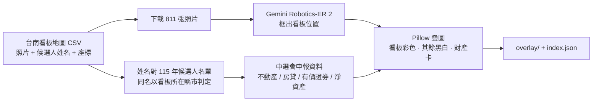

# 台南看板地圖 × 候選人財產疊圖（2026 大選）

把 [江明宗「台南看板地圖」](https://tainan.olc.tw/p/tainan2026/) 上的候選人看板照片，對上中選會 115 年候選人財產申報，產出「看板留彩色、其餘黑白、疊上財產卡」的圖。每張圖以原地圖的**地點編號（uuid）**命名，可直接接回地圖 popup。

- 線上互動版（自己拍看板就能查）：<https://candidate-billboard-1018793017785.asia-east1.run.app>
- 候選人財產透視主站：<https://sigma-snaken.github.io/candidate-wealth-tw/>
- 製作：[西格瑪機器人 Sigma Robotics](https://sigmabot.com.tw/?utm_source=github&utm_medium=tainan2026&utm_campaign=candidate-wealth)

## 數字

| 項目 | 數量 |
|---|---|
| 看板地點（原地圖 1,367 筆中，有 115 年候選人者） | 736 |
| 補拍照片 | 75 |
| 對到的候選人 | 102 位 |
| 有財產卡的地點 | 729 |
| 疊圖 | 811 張，長邊 2000 px JPEG |

地點分布：臺南市 619、新北市 60、高雄市 28、臺北市 22，其餘零星（原地圖本來就收了外縣市的回報）。

## 檔案

```
tainan2026/
  overlay/<uuid>.jpg          地點照片的疊圖（1 地點 1 張）
  overlay/<uuid>__<n>.jpg     同地點補拍照的疊圖
  index.json                  以 uuid 為 key 的索引（見下）
  candidates.csv              每位候選人：看板地點數、主要分布區、淨資產、不動產估值、房貸、有價證券、每面看板平均淨資產
  stats.json                  總覽統計
```

GitHub Pages 直接可取：

```
https://sigma-snaken.github.io/tainan2026-billboard-wealth/tainan2026/overlay/<uuid>.jpg
https://sigma-snaken.github.io/tainan2026-billboard-wealth/tainan2026/index.json
```

### index.json 一筆的欄位

```json
{
  "uuid": "fde88152-…",                 // 原地圖地點編號
  "city": "臺南市", "town": "北區", "lon": "120.198", "lat": "23.010",
  "csv_names": ["陳亭妃"],              // 原地圖標的候選人
  "candidates": [{
    "name": "陳亭妃", "seq": "2023",    // seq＝主站的候選人編號，可連到 /candidate/2023
    "city": "臺南市", "elect_type": "直轄市長", "district": "臺南市",
    "net_with_re": -154127.0,          // 淨資產（申報資產負債按市價換算，加計不動產實價登錄參考估值），元
    "re_est": 5909277, "mortgage": 6282798.0, "securities": 0,
    "how": "name"                      // name＝看板上讀到姓名；no_box＝沒框到，整張彩色卡片在下方；one_char＝罕見字一字之差
  }],
  "overlay": "fde88152-….jpg",
  "extra_overlays": ["fde88152-…__1.jpg"],
  "detections": 1, "poster_mode": false, "detect_error": null
}
```

接回地圖最省事的做法：popup 多放一張 ``，`index.json[uuid]` 有值才顯示。

## 怎麼做的



- 候選人姓名以原地圖的標註為準，AI 只負責框看板位置；框上讀到的名字對不上、或人數和框數不一致時不硬猜，整張退回「照片彩色、卡片排下方」的海報模式（38 張）。
- 同一人多面看板全部留彩色，只出一張卡。
- 淨資產＝申報資產負債按市價換算，加計不動產實價登錄參考估值（非鑑價）；股票用 2026-10-16 收盤價。細節與每位候選人的明細在主站。
- 明細完全沒解析出來的候選人，卡片寫「申報資料待補」而不是 0。

## 注意

- 2024 年拍的看板上寫「立委」，卡片上的參選職務是 2026 年的，這是正常現象。
- 林俊憲、賴清德等不在 115 年候選人名單的人沒有卡片，看板維持黑白。
- 框是矩形，斜放的看板旁會帶到一點背景。
- 原始照片版權屬台南看板地圖及各回報者；本 repo 的疊圖與資料以 [CC BY 4.0](https://creativecommons.org/licenses/by/4.0/deed.zh-hant) 釋出，使用時請同時標註「台南看板地圖（江明宗）」與「西格瑪機器人 Sigma Robotics」。
